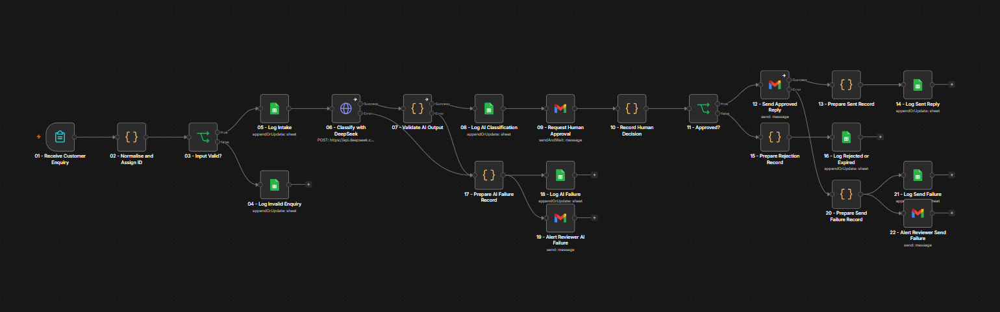
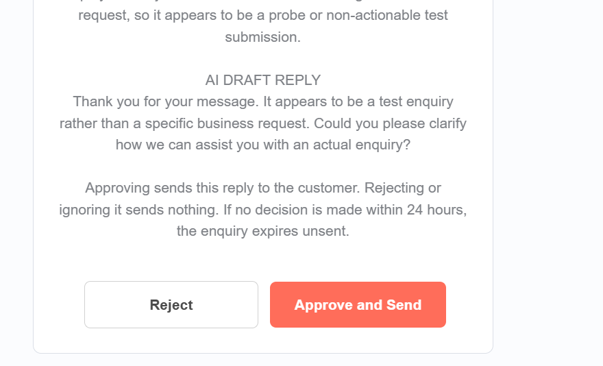

# AI Enquiry Classification with Human Approval

An n8n workflow that receives customer enquiries through a web form, classifies them with an AI model (DeepSeek), drafts a reply, and sends that reply to the customer **only after a human reviewer approves it**. Every enquiry is logged to a Google Sheet at each stage.

## Why this exists

Customer enquiries need fast answers, but an automatically sent AI reply can be wrong, invented, or inappropriate. This workflow keeps a person in control of every outgoing message and records what happened to each enquiry.

## Workflow

*Screenshot: the complete n8n workflow. Left to right: intake, validation, AI classification, human approval, then send or reject, with failure branches below.*

*Screenshot: the approval email, showing the AI draft reply and the Reject and Approve and Send buttons.*

## How it works

1. **Form intake.** A customer submits name, email, company, subject and message.
2. **Normalise and assign ID.** Fields are cleaned and checked. Each enquiry gets an ID built from the date and the n8n execution ID.
3. **Input check.** Invalid enquiries (for example, a missing name or a malformed email) are logged as invalid and stop there.
4. **Log intake.** The enquiry is written to the sheet as `Received`.
5. **AI classification.** The enquiry is sent to DeepSeek with instructions to treat its content as untrusted data, to return only a JSON object, and not to invent prices, dates or commitments.
6. **Output validation.** The AI response is checked strictly: allowed categories and urgency values, a confidence score between 0 and 1, a boolean `special_attention`, a non-empty draft, and a length limit. Truncated or malformed output goes to the failure branch.
7. **Human approval.** The reviewer receives an email with the enquiry, the classification and the draft, with **Approve and Send** and **Reject** buttons. The approval is configured to time out after 24 hours. If there is no decision in that time, the enquiry expires unsent. (The timeout has not yet been tested; see Known limitations.)
8. **Outcome.** Only an explicit approval sends the reply to the customer. Rejected, expired or unclear decisions send nothing. Every outcome is written to the sheet.
9. **Failures alert the reviewer.** An AI failure or a failed send triggers an alert email, and the sheet records the failure.

## Stack

- n8n (workflow automation)
- DeepSeek API (`deepseek-v4-flash`, OpenAI-compatible chat completions with JSON output)
- Gmail (approval request, customer reply, alerts)
- Google Sheets (audit log)

## Repository contents

| File | Purpose |
| --- | --- |
| `AI_Enquiry_Classification_Human_Approval_v4_DeepSeek.json` | The importable n8n workflow (23 nodes) |
| `README.md` | This document |
| `docs/workflow-canvas.png` | Screenshot of the complete workflow |
| `docs/approval-email.png` | Screenshot of the approval email |
| `TEST_LOG.md` | Test scenarios and recorded results |

## Sheet structure

The `Enquiries` tab has 21 columns, one row per enquiry: `enquiry_id`, `received_at`, `customer_name`, `customer_email`, `company`, `subject`, `original_message`, `processing_status`, `ai_category`, `ai_urgency`, `ai_confidence`, `ai_reasoning`, `enquiry_summary`, `ai_draft_reply`, `special_attention`, `approval_decision`, `approval_response`, `approval_timestamp`, `email_delivery_status`, `gmail_message_id`, `completed_at`.

## Setup

1. Create a Google Cloud project, enable the Gmail API and the Google Sheets API, and create a Web application OAuth client. Add your n8n OAuth redirect URL to it, and add your Gmail address as a test user while the app is in Testing mode.
2. In n8n, create three credentials:
   - **DeepSeek API key**: Header Auth, header name `Authorization`, value `Bearer <your key>`.
   - **Gmail account**: Gmail OAuth2 API, using the Client ID and Client Secret from step 1.
   - **Google Sheets account**: Google Sheets OAuth2 API, using the same client.
3. Create a Google Sheet with a tab named `Enquiries` and the 21 headers above.
4. Import the workflow JSON, keeping it inactive.
5. Link each node that uses a credential (12 nodes: 7 Sheets, 4 Gmail, 1 DeepSeek).
6. Set the Google Sheet ID in the Sheets nodes and the reviewer address in the approval and alert nodes.
7. Test each path with the scenarios in `TEST_LOG.md` before activating.

Never commit API keys, client secrets or OAuth tokens to the repository.

## Test results

Five scenarios were run on n8n against the live Gmail, Google Sheets and DeepSeek services, and each produced the expected outcome. Scenario 1 was an accidental run caused by a bug found during testing, not a designed test. Details are in `TEST_LOG.md`.

| # | Scenario | Expected | Result |
| --- | --- | --- | --- |
| 1 | Invalid input (blank fields, run during bug-fixing) | Logged as invalid, nothing else runs | Pass |
| 2 | Valid enquiry, approved | Reply sent to customer, logged as sent | Pass |
| 3 | Valid enquiry, rejected | Nothing sent, logged as rejected | Pass |
| 4 | Valid enquiry, rejected (second run) | Nothing sent, logged as rejected | Pass |
| 5 | AI failure (invalid API key) | No approval request, logged as AI failed, reviewer alerted | Pass |

## Problems found and fixed during testing

These are included because they were real, and each one was resolved:

- **Form fields arrived empty.** The normalisation step read field names that n8n didn't pass through, so every enquiry was rejected. Fixed by reading both field names and labels.
- **Google Sheets API not enabled** in the Google Cloud project. Fixed by enabling it.
- **Approval type didn't match n8n's option names.** Fixed by selecting the correct option in the approval node.
- **Gmail rate limit (HTTP 429)** after several rapid test runs. Resolved by waiting before the next run.
- **Gmail app in Testing mode** rejected a sign-in until the account was added as a test user. Fixed in the consent screen.

## Known limitations

- **No accuracy measurement.** The tests check that the workflow handles each path correctly. They don't measure how well DeepSeek classifies enquiries. A real accuracy figure would need a labelled set of enquiries and a record of the model's answers against them.
- **Small test set.** Each path was tested once or twice, with test data.
- **No automatic retry.** A failed AI call goes straight to the reviewer alert. It isn't retried.
- **Failure details are only in the alert email,** not in the sheet.
- **Customer data and DeepSeek.** DeepSeek is a China-based provider. Check whether that's acceptable before using real customer data.
- **Approval links depend on n8n being reachable** by the reviewer's browser.
- **Testing mode.** The Google OAuth app is in Testing mode, so only added test users can sign in.
- **24-hour approval timeout not yet tested.** It is configured in the approval node but has not been run to expiry.
- **Approval node behaviour** was confirmed by the test runs, but n8n versions can change field names. Re-test after upgrading n8n.
- **Model name.** The workflow uses `deepseek-v4-flash`. Check the current model name on the DeepSeek platform before importing.

## Licence

No licence has been granted yet. You may read the code, but please contact the author before reusing or redistributing it.

## Portfolio summary

Built an n8n workflow that classifies customer enquiries with an AI model, validates its output, and sends replies only after explicit human approval. The workflow logs every enquiry to Google Sheets and alerts a reviewer on failures. Approvals are configured to expire after 24 hours, which has not yet been tested. Five test scenarios covered invalid input, approval, rejection and AI failure, all passing on live services. Classification accuracy has not yet been measured.
